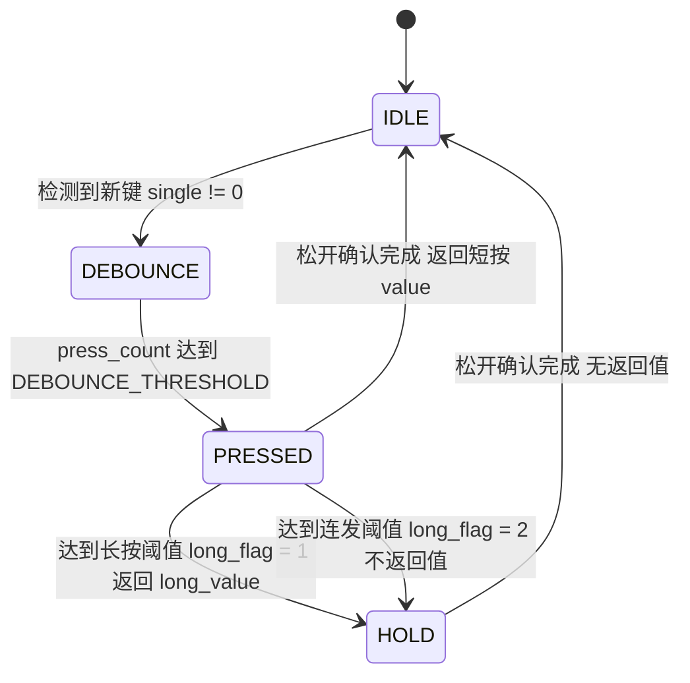
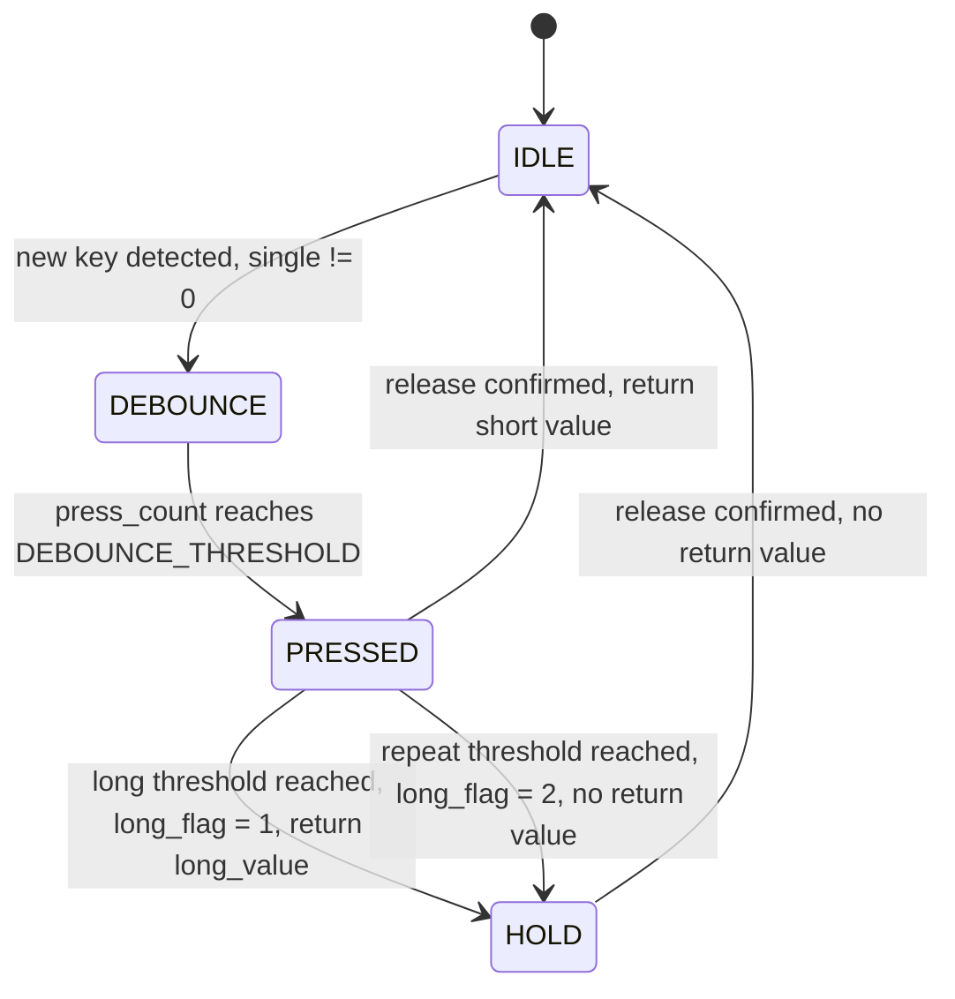

# key_touch_v3 — 按键处理模块 / Key Handling Module

> 通用多按键处理框架：消抖、短按、长按、长按连续触发（连发）、松开确认。
> A generic multi-key handling framework: debounce, short press, long press, long-press auto-repeat, and release confirmation.

**中文** | **English**

---

<a id="chinese"></a>

# 中文

## 1. 特性 Features

- **状态机实现**：`IDLE → DEBOUNCE → PRESSED → HOLD`，长按/连发与短按互斥，不会重复触发
- **两级防抖**：按下防抖（`DEBOUNCE_THRESHOLD`）+ 松开确认（`KEY_RELEASE_CONFIRM_CNT`），后者用于抑制 EFT（电场耦合）测试中的误触发
- **长按阈值可按键单独配置**：`KEYS_LIST` 中每个条目可单独指定长按节拍数，未指定则回落到全局默认值
- **短按 / 长按 / 连发三套返回值**：同一按键可返回不同的业务事件值
- **组合键支持**：按键值是位掩码，多键同时按下时可用 `|` 组合成新的键值
- **计数器饱和保护**：`press_count` 饱和于 `0xFFFF` 而非回绕，长按判定在超长按压下依然正确
- **8051 / ARM 双平台**：通过 `FLASH_CODE` / `FLASH_XDATA` 宏适配 Keil C51 与 ARM/STM32
- **不依赖硬件层**：模块只接收外部送入的原始键值，普通按键 / 触摸按键均可接入

## 2. 文件结构 File Structure

```
key_touch_v3/
├── key.h          # 模块对外接口（仅一个函数）
├── key.c          # 按键处理核心逻辑（状态机）
├── key_config.h   # 用户配置：宏定义 + 按键映射表
└── README.md      # 本文档
```

| 文件 File | 说明 Description |
| --- | --- |
| `key.h` | 模块头文件。声明唯一对外接口 `key_get(unsigned long single)` |
| `key.c` | 按键处理核心逻辑。负责去抖、短按/长按判定、连发计数、事件缓存与返回 |
| `key_config.h` | 用户配置文件。定义节拍阈值宏、`KEY_Code_t` 结构体与 `KEYS_LIST` 按键映射表 |

> **说明**：`key_touch_v3` 为**纯触摸**版本，不含 `key_init.c`，也不需要 `Key_Init()` / `Key_ScanRaw()`。原始键值由调用方（触摸 IC 驱动）读出后传入。
>
> **Note**: `key_touch_v3` is a **touch-only** build. There is no `key_init.c`, and neither `Key_Init()` nor `Key_ScanRaw()` is required. The caller reads the raw key bitmap from the touch IC driver and passes it in.

## 3. 快速开始 Quick Start

### 3.1 配置 `key_config.h`

```c
/* 关闭普通按键模式（触摸按键）——保持注释即可 */
/* #define IS_NOT_TOUCH */

/* 按键节拍阈值 */
#define DEBOUNCE_THRESHOLD   10    /* 按下防抖门限（节拍） */
#define LONG_PRESS_TICK      250   /* 长按阈值（节拍），0 关闭长按功能 */
#define LONG_PRESS_AUTO_TICK 200   /* 连发进入阈值（节拍），0 关闭连发功能 */
#define AUTO_REPEAT_INTERVAL 20    /* 连发间隔（节拍） */
#define KEY_RELEASE_CONFIRM_CNT 5  /* 松开确认计数（节拍） */
```

### 3.2 在 `KEYS_LIST` 中登记按键

```c
const KEY_Code_t FLASH_CODE KEYS_LIST[] = {
    {0x0800,           1, 101, 0,   0},  /* 清洗      短按1  长按101 无长按 */
    {0x400000,         8, 108, 1, 150},  /* 电源      短按8  长按108 长按节拍150 */
    {0x0400 | 0x0020, 29, 229, 1,   0},  /* 复合键    短按29 长按229 长按节拍用默认 */
};
```

### 3.3 调用 `key_get()`

```c
#include "key.h"

/* 由用户实现：读取触摸 IC 原始位图，0 表示无按键 */
static unsigned long touch_read(void)
{
    return g_touch_bitmap;   /* 例如 0x0800 / 0x0400|0x0020 / 0 */
}

/* 建议以 10ms 为周期调用 */
void key_task_10ms(void)
{
    unsigned char evt = key_get(touch_read());

    if (evt == 0)
        return;                 /* 无事件 */

    switch (evt)
    {
        case 1:                 /* 清洗键 短按 */
            break;
        case 101:               /* 清洗键 长按 */
            break;
        case 8:                 /* 电源键 短按 */
            break;
        case 108:               /* 电源键 长按 */
            break;
        default:
            break;
    }
}
```

## 4. 配置项说明 Configuration

### 4.1 编译期宏 Macros

| 宏 Macro | 功能 Purpose | 默认值 Default | 说明 Notes |
| --- | --- | --- | --- |
| `IS_NOT_TOUCH` | 开启普通按键模式 | 未定义（触摸模式） | 保持注释即触摸按键模式；普通按键模式需自行提供 IO 初始化与原始扫描 |
| `DEBOUNCE_THRESHOLD` | 按下防抖门限 | `10` | 连续检测到同一按键达到该节拍数才确认按下 |
| `LONG_PRESS_TICK` | 长按阈值（全局默认） | `250` | 置 `0` 关闭长按功能 |
| `LONG_PRESS_AUTO_TICK` | 连发进入阈值（全局默认） | `200` | 置 `0` 关闭连发功能 |
| `AUTO_REPEAT_INTERVAL` | 连发间隔 | `20` | 进入连发后，每隔该节拍数返回一次长按事件 |
| `KEY_RELEASE_CONFIRM_CNT` | 松开确认计数 | `5` | 连续检测到松开达到该节拍数才确认释放 |
| `KEYS_COUNT` | 按键表长度 | 自动计算 | 由 `sizeof` 推导，新增按键无需手工维护 |

> **时间单位说明**：以上阈值全部以**节拍（tick）** 为单位，真实时间 = 节拍数 × 调用周期。模块内部不假定固定周期，节拍由调用方决定。本文示例以 **10ms/节拍** 为准：`DEBOUNCE_THRESHOLD=10` → 100ms；`LONG_PRESS_TICK=250` → 2.5s；`AUTO_REPEAT_INTERVAL=20` → 200ms；`KEY_RELEASE_CONFIRM_CNT=5` → 50ms。
>
> **Unit note**: every threshold above is expressed in **ticks**, so the real duration is *ticks × caller period*. The module itself does not assume a fixed period. With a 10 ms tick: debounce 100 ms, long press 2.5 s, auto-repeat interval 200 ms, release confirm 50 ms.

### 4.2 按键映射表 `KEYS_LIST`

结构体定义（`key_config.h`）：

```c
typedef struct
{
    unsigned long single;         /* 原始键值（触摸位掩码）*/
    unsigned char value;          /* 短按返回值 */
    unsigned char long_value;     /* 长按返回值 */
    unsigned char long_flag;      /* 长按标记：0=无 1=单次长按 2=长按连发 */
    unsigned int  key_press_tick; /* 该键单独的长按节拍数，0 表示用全局默认 */
} KEY_Code_t;
```

当前配置（`key_touch_v3/key_config.h`）：

| 原始键值 `single` | 功能 Function | 短按 `value` | 长按 `long_value` | `long_flag` | `key_press_tick` |
| --- | --- | --- | --- | --- | --- |
| `0x0800` | 清洗 Wash | 1 | 101 | 0 | — |
| `0x1000` | 蒸汽 Steam | 2 | 103 | 0 | — |
| `0x2000` | 烘干 Dry | 3 | 105 | 0 | — |
| `0x0400` | 保管 Store | 4 | 102 | 0 | — |
| `0x0080` | 灯 Light | 5 | 104 | 0 | — |
| `0x0040` | 清洁 Clean | 6 | 106 | 0 | — |
| `0x0020` | 暂停/继续 Pause | 7 | 107 | 0 | — |
| `0x400000` | 电源 Power | 8 | 108 | 1 | 150 |
| `0x0400 \| 0x0020` | 复合键：保管 + 暂停/继续（自检） | 29 | 229 | 1 | 0 → 用默认 `LONG_PRESS_TICK` |

**`long_flag` 语义**

| 值 | 含义 | 行为 Behavior |
| --- | --- | --- |
| `0` | 无长按功能 | 仅返回短按值 |
| `1` | 单次长按 | 达到长按阈值时返回一次 `long_value`，随后不再重复 |
| `2` | 长按连发 | 达到连发阈值后进入连发，每隔 `AUTO_REPEAT_INTERVAL` 返回一次 `long_value` |

> 当前配置表中未使用 `long_flag = 2` 的条目，但代码已完整支持连发逻辑，可按需启用。

## 5. 状态机 State Machine



| 状态 State | 说明 Description |
| --- | --- |
| `IDLE` | 空闲，无按键按下 |
| `DEBOUNCE` | 防抖中，检测到新键后开始累计稳定节拍数 |
| `PRESSED` | 已确认按下，开始累计长按节拍数 |
| `HOLD` | 长按保持阶段，单次长按在此静默，连发在此按间隔返回事件 |

### 5.1 事件触发时机 When Events Fire

| 事件 Event | 触发条件 Trigger | 返回时机 Timing |
| --- | --- | --- |
| 短按 Short press | 长按阈值未达到，按键被释放 | **松开确认完成后**返回（延迟 `KEY_RELEASE_CONFIRM_CNT` 个节拍） |
| 单次长按 Long press | `long_flag = 1` 且节拍数达到长按阈值 | **达到阈值的那一刻**立即返回（不等到松开） |
| 连发 Auto-repeat | `long_flag = 2` 且节拍数达到连发阈值 | 进入连发后，每隔 `AUTO_REPEAT_INTERVAL` 返回一次 |

> **重要**：长按事件在按下期间即返回；短按事件在松开确认后才返回。同一按键一次按下只可能产生长按或短按其中之一，不会两者都触发。

## 6. API 参考 API Reference

### `unsigned char key_get(unsigned long single)`

处理一帧按键输入并返回事件值。

**参数 Parameters**

| 参数 | 类型 | 说明 |
| --- | --- | --- |
| `single` | `unsigned long` | 本次扫描到的原始键值。`0` 表示无按键按下；非 `0` 为 `KEYS_LIST` 中登记的键值（触摸模式为位掩码） |

**返回值 Return value**

| 返回值 | 含义 |
| --- | --- |
| `0` | 本次调用无事件（无按键、仍在防抖、或事件尚未到期） |
| `1` ~ `255` | 事件值，具体含义由 `KEYS_LIST` 的 `value` / `long_value` 定义 |

**说明 Notes**

- 该函数为**有状态**接口，内部使用静态变量维护状态机，**必须按固定周期被调用**（建议 10ms），阈值才具有预期的时间含义
- 非重入（not reentrant），不可在中断与主循环中并发调用
- `single` 必须传入**当前时刻的原始键值**；不同键值之间通过 `single != last_key` 判定为一次新的按下
- `press_count` 饱和于 `0xFFFF`（不回绕），超长按压下长按判定依然正确

**示例 Example**

```c
unsigned char evt = key_get(read_touch_bitmap());
if (evt == 101) {
    /* 清洗键长按 */
}
```

## 7. 移植说明 Porting Notes

1. **提供原始键值**：模块不读取任何寄存器，调用方需自行实现原始键值读取（触摸 IC / GPIO / 矩阵扫描）
2. **节拍周期**：确定你的定时器周期，并据此换算 `key_config.h` 中的节拍阈值
3. **8051 适配**：`key_config.h` 已定义 `FLASH_CODE`（`code`）与 `FLASH_XDATA`（`xdata`），Keil C51 下自动生效；ARM/STM32 下为空宏
4. **按键表位置**：`KEYS_LIST` 建议只被 `key.c` 包含一次（详见第 9 节）

## 8. 已知限制 Known Caveats

- **重复包含风险**：`key_config.h` 中 `KEYS_LIST` 是带外部链接的数组定义。在 C 语言中 `const` **不**代表内部链接，因此若在多个 `.c` 文件中包含 `key_config.h`，会出现 `multiple definition of 'KEYS_LIST'` 链接错误。当前 `key.h` **不**包含 `key_config.h`，因此调用方只包含 `key.h` 即可规避；如需使用配置宏，建议将 `KEYS_LIST` 移入 `key.c` 或单独的头/源文件分离
- **`IS_NOT_TOUCH` 仅为占位**：v3 未提供普通按键的 IO 初始化与扫描实现，若需普通按键模式请自行补齐 `Key_Init()` / `Key_ScanRaw()` 并在 `key_config.h` 中定义该宏
- **长按事件占用返回通道**：长按事件在按下期间返回，若调用方在长按触发后又做了一次短按判断，会出现业务语义上的重复响应，需由业务层按 `long_value` 区分处理
- **节拍语义依赖调用周期**：若调用周期不固定，所有时间阈值会同步漂移

## 9. 版本演进与变更记录 Version History & Changelog

| 版本 Version | 目录 Directory | 关键变更 Key Changes |
| --- | --- | --- |
| v1 | `key/` | 初版，普通按键实现，基于 `KEY_LIST` 宏与 `Key_GetKey()` 接口 |
| v1-touch | `key_touch/` | 改造成触摸按键，引入 `KEYS_LIST` 结构体映射表与 `key_get()` 接口，支持普通/触摸双模式（`IS_NOT_TOUCH`） |
| v2 | `key_touch_v2/` | 新增每个按键单独配置长按时间（`key_press_tick`），引入 `FLASH_CODE` / `FLASH_XDATA` 跨平台宏 |
| **v3** | `key_touch_v3/` | 新增松开确认计数 `KEY_RELEASE_CONFIRM_CNT`（抑制 EFT 误触发）；修正 v2 中 `key_press_tick = 0` 时长按阈值被误判为立即触发的问题；复合键改用 `0x0400 \| 0x0020` 表达式以提升可读性；代码风格统一为 Allman 缩进 |

### v3 相对 v2 的具体修复

v2 的 `keys_press_tick()` 逻辑为：

```c
if (KEYS_LIST[i].long_flag && last_key == KEYS_LIST[i].single)
    return KEYS_LIST[i].key_press_tick;   /* 可能返回 0 */
```

当某键 `long_flag = 1` 且 `key_press_tick = 0` 时，该函数返回 `0`，导致 `press_count >= 0` 恒成立，**长按在按下后立即触发**。v3 增加了 `key_press_tick` 非零判断：

```c
if (KEYS_LIST[i].key_press_tick && KEYS_LIST[i].long_flag && last_key == KEYS_LIST[i].single)
    return KEYS_LIST[i].key_press_tick;   /* 仅在单独配置了阈值时生效 */
```

`key_press_tick = 0` 现在正确回落到全局默认 `LONG_PRESS_TICK` / `LONG_PRESS_AUTO_TICK`。

---

<a id="english"></a>

# English

## 1. Features

- **State-machine based**: `IDLE → DEBOUNCE → PRESSED → HOLD`. Long press and short press are mutually exclusive and never double-fire.
- **Two-stage debounce**: press debounce (`DEBOUNCE_THRESHOLD`) plus release confirmation (`KEY_RELEASE_CONFIRM_CNT`); the latter suppresses false triggers during EFT (electric-field coupling) testing.
- **Per-key long-press threshold**: each `KEYS_LIST` entry may define its own long-press tick count; entries that omit it fall back to the global default.
- **Three event channels**: short press, long press, and auto-repeat each return a distinct business event value.
- **Combo-key support**: key values are bitmasks, so simultaneous presses can be combined with `|` into a new key value.
- **Saturating counter**: `press_count` saturates at `0xFFFF` instead of wrapping, so long-press detection stays correct even for very long holds.
- **8051 and ARM**: `FLASH_CODE` / `FLASH_XDATA` macros adapt the module to Keil C51 and ARM/STM32.
- **Hardware agnostic**: the module only consumes a raw key value supplied by the caller, so both normal buttons and touch keys can drive it.

## 2. File Structure

```
key_touch_v3/
├── key.h          # Public interface (a single function)
├── key.c          # Core key-handling logic (state machine)
├── key_config.h   # User configuration: macros + key mapping table
└── README.md      # This document
```

| File | Description |
| --- | --- |
| `key.h` | Module header. Declares the only public interface, `key_get(unsigned long single)` |
| `key.c` | Core logic. Handles debounce, short/long press detection, repeat counting, and event buffering |
| `key_config.h` | User configuration. Defines the tick-threshold macros, the `KEY_Code_t` struct, and the `KEYS_LIST` mapping table |

> **Note**: `key_touch_v3` is a **touch-only** build. There is no `key_init.c`, and neither `Key_Init()` nor `Key_ScanRaw()` is required. The caller reads the raw key bitmap from the touch IC driver and passes it in.

## 3. Quick Start

### 3.1 Configure `key_config.h`

```c
/* Normal-button mode (leave commented for touch keys) */
/* #define IS_NOT_TOUCH */

/* Tick thresholds */
#define DEBOUNCE_THRESHOLD   10    /* Press debounce gate (ticks) */
#define LONG_PRESS_TICK      250   /* Long-press threshold (ticks), 0 disables long press */
#define LONG_PRESS_AUTO_TICK 200   /* Auto-repeat entry threshold (ticks), 0 disables repeat */
#define AUTO_REPEAT_INTERVAL 20    /* Auto-repeat interval (ticks) */
#define KEY_RELEASE_CONFIRM_CNT 5  /* Release confirmation count (ticks) */
```

### 3.2 Register keys in `KEYS_LIST`

```c
const KEY_Code_t FLASH_CODE KEYS_LIST[] = {
    {0x0800,           1, 101, 0,   0},  /* Wash   short 1, long 101, no long press */
    {0x400000,         8, 108, 1, 150},  /* Power  short 8, long 108, 150-tick long press */
    {0x0400 | 0x0020, 29, 229, 1,   0},  /* Combo  short 29, long 229, default long threshold */
};
```

### 3.3 Call `key_get()`

```c
#include "key.h"

/* User-supplied: read the raw touch IC bitmap; 0 means no key pressed */
static unsigned long touch_read(void)
{
    return g_touch_bitmap;   /* e.g. 0x0800 / 0x0400|0x0020 / 0 */
}

/* Recommended call period: 10 ms */
void key_task_10ms(void)
{
    unsigned char evt = key_get(touch_read());

    if (evt == 0)
        return;                 /* no event */

    switch (evt)
    {
        case 1:                 /* Wash, short press */
            break;
        case 101:               /* Wash, long press */
            break;
        case 8:                 /* Power, short press */
            break;
        case 108:               /* Power, long press */
            break;
        default:
            break;
    }
}
```

## 4. Configuration

### 4.1 Compile-time Macros

| Macro | Purpose | Default | Notes |
| --- | --- | --- | --- |
| `IS_NOT_TOUCH` | Enable normal-button mode | Undefined (touch mode) | Leave commented for touch keys; normal-button mode requires your own IO init and raw scan |
| `DEBOUNCE_THRESHOLD` | Press debounce gate | `10` | The key must be seen stable for this many ticks before the press is confirmed |
| `LONG_PRESS_TICK` | Long-press threshold (global default) | `250` | Set to `0` to disable long press |
| `LONG_PRESS_AUTO_TICK` | Auto-repeat entry threshold (global default) | `200` | Set to `0` to disable auto-repeat |
| `AUTO_REPEAT_INTERVAL` | Auto-repeat interval | `20` | While repeating, the long event is returned every this many ticks |
| `KEY_RELEASE_CONFIRM_CNT` | Release confirmation count | `5` | The release must persist for this many ticks before it is accepted |
| `KEYS_COUNT` | Number of table entries | Auto-computed | Derived via `sizeof`; no manual upkeep when adding keys |

> **Unit note**: every threshold above is expressed in **ticks**, so the real duration is *ticks × caller period*. The module itself does not assume a fixed period. With a 10 ms tick: debounce 100 ms, long press 2.5 s, auto-repeat interval 200 ms, release confirm 50 ms.

### 4.2 Key Mapping Table `KEYS_LIST`

Struct definition (in `key_config.h`):

```c
typedef struct
{
    unsigned long single;         /* Raw key value (touch bitmask) */
    unsigned char value;          /* Short-press return value */
    unsigned char long_value;     /* Long-press return value */
    unsigned char long_flag;      /* Long-press flag: 0=none 1=single 2=auto-repeat */
    unsigned int  key_press_tick; /* Per-key long-press ticks; 0 means use the global default */
} KEY_Code_t;
```

Current configuration (`key_touch_v3/key_config.h`):

| Raw key `single` | Function | Short `value` | Long `long_value` | `long_flag` | `key_press_tick` |
| --- | --- | --- | --- | --- | --- |
| `0x0800` | Wash | 1 | 101 | 0 | — |
| `0x1000` | Steam | 2 | 103 | 0 | — |
| `0x2000` | Dry | 3 | 105 | 0 | — |
| `0x0400` | Store | 4 | 102 | 0 | — |
| `0x0080` | Light | 5 | 104 | 0 | — |
| `0x0040` | Clean | 6 | 106 | 0 | — |
| `0x0020` | Pause / Resume | 7 | 107 | 0 | — |
| `0x400000` | Power | 8 | 108 | 1 | 150 |
| `0x0400 \| 0x0020` | Combo: Store + Pause (self-test) | 29 | 229 | 1 | 0 → uses default `LONG_PRESS_TICK` |

**`long_flag` semantics**

| Value | Meaning | Behavior |
| --- | --- | --- |
| `0` | No long press | Only the short-press value is returned |
| `1` | Single long press | `long_value` is returned once when the threshold is reached, then never again |
| `2` | Long-press auto-repeat | After the repeat threshold is reached, `long_value` is returned every `AUTO_REPEAT_INTERVAL` ticks |

> The shipped configuration contains no `long_flag = 2` entry, but the auto-repeat logic is fully implemented and can be enabled as needed.

## 5. State Machine



| State | Description |
| --- | --- |
| `IDLE` | Idle, no key pressed |
| `DEBOUNCE` | Debouncing; counts stable ticks since a new key was detected |
| `PRESSED` | Press confirmed; starts accumulating long-press ticks |
| `HOLD` | Long-press hold phase; silent for a single long press, fires on an interval for auto-repeat |

### 5.1 When Events Fire

| Event | Trigger | Timing of the return |
| --- | --- | --- |
| Short press | The long-press threshold was not reached and the key is released | Returned **after release confirmation** (delayed by `KEY_RELEASE_CONFIRM_CNT` ticks) |
| Single long press | `long_flag = 1` and the tick count reaches the long threshold | Returned **immediately at the threshold**, without waiting for release |
| Auto-repeat | `long_flag = 2` and the tick count reaches the repeat threshold | Returned every `AUTO_REPEAT_INTERVAL` ticks once repeating has started |

> **Important**: the long-press event is returned *during* the press, while the short-press event is returned *after* release confirmation. A single press yields either a long press or a short press, never both.

## 6. API Reference

### `unsigned char key_get(unsigned long single)`

Processes one frame of key input and returns the event value.

**Parameters**

| Parameter | Type | Description |
| --- | --- | --- |
| `single` | `unsigned long` | The raw key value read in this scan. `0` means no key is pressed; a non-zero value is a key registered in `KEYS_LIST` (a bitmask in touch mode) |

**Return value**

| Value | Meaning |
| --- | --- |
| `0` | No event on this call (no key, still debouncing, or the event is not due yet) |
| `1` ~ `255` | An event value; the exact meaning is defined by the `value` / `long_value` fields in `KEYS_LIST` |

**Notes**

- This is a **stateful** interface: internal static variables drive the state machine, so it **must be called at a fixed period** (10 ms recommended) for the thresholds to carry their intended time meaning.
- Not reentrant — do not call it concurrently from an ISR and the main loop.
- `single` must carry the **current** raw key value; a change relative to `last_key` is treated as a new press.
- `press_count` saturates at `0xFFFF` rather than wrapping, so long-press detection remains correct under an extremely long hold.

**Example**

```c
unsigned char evt = key_get(read_touch_bitmap());
if (evt == 101) {
    /* Wash key long press */
}
```

## 7. Porting Notes

1. **Supply the raw key value**: the module reads no registers. You implement the raw read (touch IC, GPIO, or matrix scan).
2. **Tick period**: settle on your timer period, then convert the tick thresholds in `key_config.h` accordingly.
3. **8051 support**: `key_config.h` defines `FLASH_CODE` (`code`) and `FLASH_XDATA` (`xdata`), which take effect automatically under Keil C51 and expand to nothing on ARM/STM32.
4. **Table placement**: keep `KEYS_LIST` included by `key.c` only (see section 8).

## 8. Known Caveats

- **Risk of duplicate inclusion**: `KEYS_LIST` in `key_config.h` is an array definition with external linkage. In C, `const` does **not** imply internal linkage, so including `key_config.h` in more than one `.c` file produces a `multiple definition of 'KEYS_LIST'` link error. `key.h` deliberately does **not** include `key_config.h`, so callers that include only `key.h` are unaffected; if you need the config macros, move `KEYS_LIST` into `key.c` or split it into a separate header/source pair.
- **`IS_NOT_TOUCH` is a placeholder only**: v3 ships no normal-button IO initialization or scan implementation. To use normal-button mode, provide your own `Key_Init()` / `Key_ScanRaw()` and define the macro in `key_config.h`.
- **Long press occupies the return channel**: the long-press event is returned while the key is still held. If the caller performs an additional short-press check after a long press fires, the business logic sees a semantically duplicated response; distinguish it by `long_value` at the application layer.
- **Thresholds depend on the call period**: if the call period is not fixed, all time thresholds drift proportionally.

## 9. Version History & Changelog

| Version | Directory | Key changes |
| --- | --- | --- |
| v1 | `key/` | Initial release, normal-button implementation based on the `KEY_LIST` macro and the `Key_GetKey()` interface |
| v1-touch | `key_touch/` | Converted to touch keys; introduced the `KEYS_LIST` struct-based mapping table and the `key_get()` interface; supports both normal and touch modes (`IS_NOT_TOUCH`) |
| v2 | `key_touch_v2/` | Added per-key long-press timing (`key_press_tick`); introduced the `FLASH_CODE` / `FLASH_XDATA` cross-platform macros |
| **v3** | `key_touch_v3/` | Added the release-confirmation counter `KEY_RELEASE_CONFIRM_CNT` (suppresses EFT false triggers); fixed the v2 bug where `key_press_tick = 0` caused an immediate long press; combo key rewritten as `0x0400 \| 0x0020` for readability; code style unified to Allman indentation |

### The v3 fix in detail

The v2 `keys_press_tick()` looked like this:

```c
if (KEYS_LIST[i].long_flag && last_key == KEYS_LIST[i].single)
    return KEYS_LIST[i].key_press_tick;   /* may return 0 */
```

When a key had `long_flag = 1` and `key_press_tick = 0`, the function returned `0`, making `press_count >= 0` always true, so the **long press fired immediately after the press was confirmed**. v3 adds a non-zero check on `key_press_tick`:

```c
if (KEYS_LIST[i].key_press_tick && KEYS_LIST[i].long_flag && last_key == KEYS_LIST[i].single)
    return KEYS_LIST[i].key_press_tick;   /* applies only when explicitly configured */
```

A `key_press_tick` of `0` now correctly falls back to the global `LONG_PRESS_TICK` / `LONG_PRESS_AUTO_TICK`.

## 10. License

This module is distributed together with the parent project. If the repository provides no `LICENSE` file, all rights are reserved by default.
